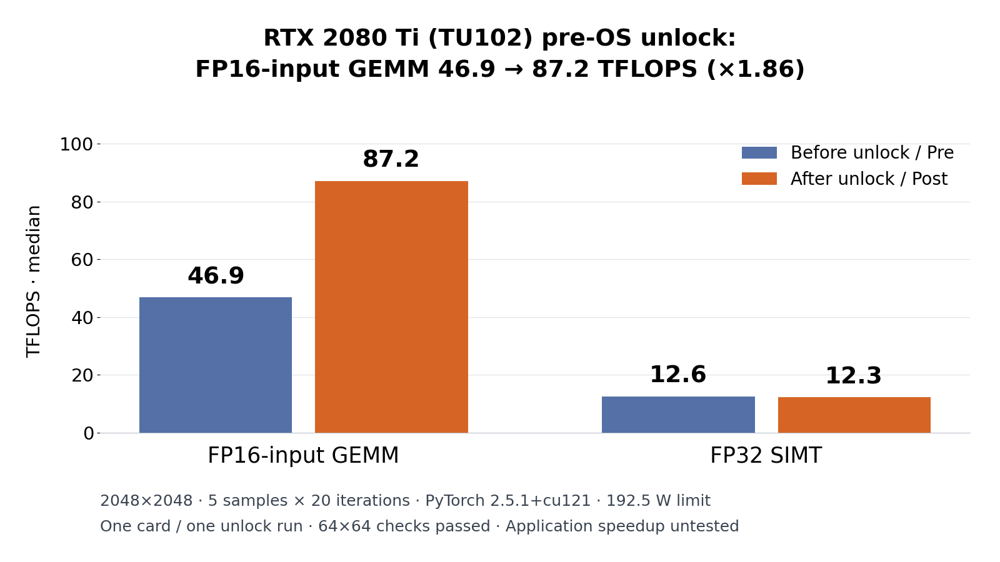

# RTX 2080 Ti（TU102）pre-OS 解除の実測記録

Onside の技術事例として、手持ちの NVIDIA GeForce RTX 2080 Ti（TU102）1台で、上流の `nv-uefi-unlocker` を使った pre-OS 解除を1回実行し、前後の行列積を測定しました。FP16 入力 GEMM の中央値は 46.88→87.17 TFLOPS（約1.86倍）、FP32 SIMT は 12.61→12.27 TFLOPSでした。これは短時間のマイクロベンチマークの結果であり、ローカル LLM や画像生成の処理全体が同じ倍率で速くなることを示すものではありません。

著者：Onside Lab

## 結果

| 測定項目 | 解除前 | 解除後 | 後／前 |
| --- | ---: | ---: | ---: |
| FP16 入力 GEMM（TFLOPS） | 46.88 | 87.17 | 1.86 |
| FP32 SIMT（TFLOPS） | 12.61 | 12.27 | 0.97 |
| 64×64 CPU float64 参照による数値検算 | 合格 | 合格 | — |
| 電力上限（W） | 192.5 | 192.5 | — |
| SM クロックの代表値（MHz） | 1590 | 1575 | — |

行列サイズは2048×2048、10回の warmup 後に20回の積を1標本として5標本を測定し、TFLOPS の中央値を比較しました。計算量は1積あたり `2 × N³` としています。表とグラフだけを丸め、[benchmark.json](results/benchmark.json) には元の中央値を保存しています。電力上限は実消費電力ではありません。クロックは固定しておらず、元の標本内には解除前1350 MHz、解除後1635 MHzの観測もあります。

PyTorch 2.5.1+cu121 を使用し、TF32 と FP16 の reduced-precision reduction を無効にしました。FP16 は**入力型の表記**です。実際のカーネルの累積型は独立に計測していないため、FP32 累積の性能とは断定しません。数値検算は64×64の別問題に対する確認で、2048×2048の全要素を検査した結果ではありません。FP32 の小幅な低下についても、2回の測定だけで原因や有意差は判断できません。

## 環境

| 項目 | 記録 |
| --- | --- |
| GPU | NVIDIA GeForce RTX 2080 Ti（TU102） |
| PCI ID | `10de:1e04` |
| サブシステム ID | `1043:8675` |
| VBIOS | `90.02.17.00.b2` |
| OS | Windows 11 |
| NVIDIA ドライバー | `610.88` |
| ドライバーの動作モード | GSP-RM モード（GSP firmware `610.57.01`） |
| PyTorch | `2.5.1+cu121` |
| 電力上限 | 192.5 W（前後で同じ） |
| 上流の固定版 | v2.1.6 |
| 上流 commit | [`9932cfbe1c2f6ebc0759139a2b0949703c00f82f`](https://github.com/physicsdolphin/nv-uefi-unlocker/tree/9932cfbe1c2f6ebc0759139a2b0949703c00f82f) |

## 進め方の概要

実行ファイルの配布や自動解除の仕組みは提供していません。実機で行った工程は次のとおりです。

| 段階 | 進むための関門 | 中止・戻し方 |
| --- | --- | --- |
| 診断 | GPU の識別情報と固定版を照合し、読み取り専用の診断と解除前の測定を確認 | 診断で不一致や異常があれば解除へ進まず、通常の Windows 起動に戻す |
| GSP モード | 変更前の設定を控え、GSP モードを有効にして再起動し、設定値と実際の GSP firmware 動作を確認 | 異常があれば解除せず、控えた設定へ復元して再起動する |
| 解除の1回起動 | 固定版の実行物と資産を照合し、一時的な起動メニューから入り、確認画面を経て1回だけ実行 | 確認前なら中止する。実行途中の STOP・異常後は同じセッションで再実行せず、完全に電源を切り、解除用媒体を外して通常起動する |
| Windows 復帰後 | ログの Turing 側の選択値と、同条件での測定・数値検算を確認 | 表示・ドライバー異常や検算失敗があれば運用を止め、完全な電源断後に解除を通さず通常起動する |

GSP の設定変更は解除状態とは別に残るため、元の環境へ戻す際はその設定も復元します。解除自体は揮発性で、使用する起動ごとに再実行が必要です。復旧方法の準備を設けても、復旧を保証するものではありません。上流の[固定版 README](https://github.com/physicsdolphin/nv-uefi-unlocker/blob/9932cfbe1c2f6ebc0759139a2b0949703c00f82f/README.md)に前提と復旧手順があります。

[loader の抜粋](logs/loader-tx-excerpt.log)には元の行番号を残しました。SAMPLE では Turing FEAT_PLM=`0xffffff8f`、SS0=`0x00002100`、FWSEC では WPR2 検証通過、POST-BOOT では FEAT_PLM=`0xffffffff`、その後に SS0=`0x88888888`／SS1=`0x8` が記録されています。relock と最終交棒の Turing 側にも選択値が残り、`tu10x_unlock=true` が出ています。一方で BOOTER-DIRECT の診断には `signature DMA never landed` という記録があります。抜粋では両方を保持し、ログの文言だけで実行機序が証明されたとは扱いません。

## 検証していないこと

- 対象は1台、解除の実行は1回です。複数回の起動で再現するか、他の個体・VBIOS・ドライバーで同じ結果になるかは未検証です。
- 長時間の連続負荷、スリープ・休止状態からの復帰、ゲームの動作は未検証です。
- ローカル LLM の tokens/s、画像生成の所要時間、業務での安定性・費用対効果は測定していません。
- Windows 内での FEAT レジスターの独立した読戻しは行っていません。EFI 側のログと Windows 側の性能変化を区別しています。
- 永続化・毎回の自動起動は検証していません。揮発性の解除であり、恒久的な性能変更ではありません。

## 収録物とクレジット

- [Onside の事例](docs/case-study-ja.md)
- [実測値の要約](results/benchmark.json)
- [loader ログの限定抜粋](logs/loader-tx-excerpt.log)
- [独立に作成した汎用 GEMM 測定スクリプト](bench/gemm_bench.py)

解除の実装は [physicsdolphin/nv-uefi-unlocker](https://github.com/physicsdolphin/nv-uefi-unlocker) によるものです。本リポジトリの成果は、固定版を使った実機検証の記録と自作の測定スクリプトです。解除技術そのものを独自開発したという主張ではありません。

上流のコード・NVIDIA のファームウェア・ビルドした EFI は含みません。上流は GPL-2.0-only、NVIDIA のファームウェアは配布不可として扱い、再配布しません。自作の文章とスクリプトは [MIT License](LICENSE) です。ログは上流プログラムの実行出力の限定抜粋であり、その文字列に独自の権利を主張しません。

同梱の測定スクリプトは元の測定プログラムのコピーではありません。PyTorch と CUDA 対応環境を別途用意した上で `python bench/gemm_bench.py` で実行できます。warmup・中央値・小行列の検算を備えていますが、保存済みの実測値を生成したプログラムそのものではなく、同じ数値の再現を保証しません。識別情報や機器の一覧は出力せず、測定結果を標準出力へ JSON で返します。

## 免責・サポート

実行・利用は自己責任です。動作、性能、復旧を含め一切保証しません。本リポジトリは事例の記録であり、個別環境へのサポートは行いません。質問は受け付けません。GitHub Issues・Pull Requests は受け付けません（リポジトリは読み取り専用・サポートなし）。

## English summary

One RTX 2080 Ti (TU102) was tested with one pre-OS unlock run using upstream v2.1.6, commit `9932cfbe1c2f6ebc0759139a2b0949703c00f82f`. Median FP16-input GEMM increased from 46.88 to 87.17 TFLOPS (1.86×); FP32 SIMT changed from 12.61 to 12.27 TFLOPS. Both 64×64 CPU-float64 reference checks passed. Matrix size: 2048; five samples of twenty products; PyTorch 2.5.1+cu121; power limit: 192.5 W.

This is a short microbenchmark, not an application speedup or stability claim. Accumulation precision was not independently traced. Long-duration loads, sleep/resume, games and repeat-boot reproducibility remain untested. The unlock is volatile and must be reapplied for each boot where it is needed.

Credit: [nv-uefi-unlocker](https://github.com/physicsdolphin/nv-uefi-unlocker). No upstream source, NVIDIA firmware or built EFI is included. Original writing and scripts are MIT-licensed. Use at your own risk; no warranty, support or questions accepted. This repository is read-only; GitHub Issues and Pull Requests are not accepted. Author: Onside Lab.
