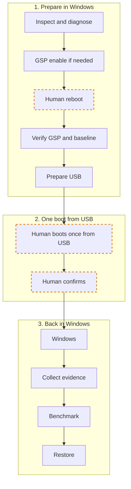

# RTX 2080 Ti Windows Unlock Kit — Measured 1.86x FP16-input GEMM

Windows GSP and one-boot USB tools for the RTX 2080 Ti (TU102), with measurements by Onside Lab; the unlock implementation is [physicsdolphin/nv-uefi-unlocker](https://github.com/physicsdolphin/nv-uefi-unlocker), pinned to v2.1.6.

**Tested on ONE machine, in one unlock run.** We ran the unlock at boot from a memory card in a USB card reader. This free kit contains only the generalized, shareable part of what we used. **The kit was NOT re-tested on real hardware after generalization.** It is a technical case study and portfolio piece, intended for people who understand their own system. Use is at your own risk, with no warranty of operation, performance, or recovery.

Issues are closed; use [Discussions](https://github.com/onside-lab/rtx-2080-ti-11gb-turing-unlock-windows-kit/discussions) for ideas and results; no individual support.


| Metric | Before unlock | After unlock | After / Before |
| --- | ---: | ---: | ---: |
| Median FP16-input GEMM (TFLOPS) | 46.88 | 87.17 | 1.86 |
| Median FP32 SIMT (TFLOPS) | 12.61 | 12.27 | 0.97 |
| Numerical verification against 64×64 CPU float64 reference | Passed | Passed | — |
| Power limit (W) | 192.5 | 192.5 | — |
| Representative SM clock (MHz) | 1590 | 1575 | — |

These are short microbenchmark results. FP16 means the **input data type**; kernel accumulation precision was not independently measured. Local LLM response latency, tokens/s, and image generation time were not measured. The power limit is not actual power consumption, and clocks were not locked.

## What you get

- GSP registry preflight, a backup before a conditional change, restore, and post-reboot verification.
- A dedicated USB writer that checks media identity, an explicit Volume GUID, and a local payload manifest; it copies and reads back files without formatting or overwriting existing files.
- Return collection that preserves the loader log and checks Windows evidence. A candidate verdict is not proof of a successful unlock.
- An [independent GEMM benchmark](bench/gemm_bench.py), the [case study](docs/case-study.md), [measurement data](results/benchmark.json), and a [loader excerpt](logs/loader-tx-excerpt.log).
- A short [AGENTS.md](AGENTS.md) entrypoint for coding agents, [reproduction steps](docs/reproduce.md), and [recovery steps](docs/recovery.md).

The kit does not download, build, or distribute an EFI payload and does not automate the unlock at boot.

## Before you start

### Tested configuration

| Item | Value |
| --- | --- |
| GPU | NVIDIA GeForce RTX 2080 Ti (TU102) |
| PCI ID | `10de:1e04` |
| Subsystem ID | `1043:8675` |
| VBIOS | `90.02.17.00.b2` |
| OS | Windows 11 |
| NVIDIA driver | `610.88` |
| Driver operating mode | GSP-RM mode (GSP firmware `610.57.01`) |
| PyTorch | `2.5.1+cu121` |
| Power limit | 192.5 W, identical before and after |
| Upstream release | v2.1.6 |
| Upstream commit | [`9932cfbe1c2f6ebc0759139a2b0949703c00f82f`](https://github.com/physicsdolphin/nv-uefi-unlocker/tree/9932cfbe1c2f6ebc0759139a2b0949703c00f82f) |

Other cards, hardware units, subsystems, VBIOS versions, drivers, and repeated boots are untested. So are sustained workloads, sleep/hibernate resume, gaming, production stability, and cost-effectiveness. No independent Windows readback of FEAT registers was performed. Configurable identifiers do not establish broader compatibility. The checks require `10de:1e04`, the matching configured subsystem, UUID and PnP/driver-key binding, and one NVIDIA display GPU.

You need:

- A Turing GPU and Windows; this kit's initial scope is the single RTX 2080 Ti above. Other RTX 20 cards are outside the current checks.
- Python (tested with 3.11.15) and Windows PowerShell (tested with 5.1). An elevated terminal is required for GSP writes and USB copying; some inspection evidence also requires elevation.
- Upstream **nv-uefi-unlocker v2.1.6**, obtained and verified by you, including the instructions and locally prepared TU10x payload for that commit.
- A blank, dedicated USB device or memory card in a USB reader, already prepared as a single FAT32 volume. The writer never formats or partitions media.
- Knowledge of your UEFI boot menu and recovery path. Record Secure Boot and any BIOS **OS type** setting before changes; names and behavior vary by motherboard. Follow the pinned upstream requirements, and have the human make and later restore any required BIOS changes.
- Your disk-encryption recovery key at hand, recovery instructions saved on another device, and a way to boot normally without the unlock media. Do not put recovery keys in this repo or its reports.
- A CUDA-capable PyTorch environment for benchmarking, with comparable settings before and after.

## Quick start

Start with inspection only. Read [AGENTS.md](AGENTS.md), [reproduce.md](docs/reproduce.md), and [recovery.md](docs/recovery.md). Create local settings from the empty templates and confirm the GPU identity before running:

```powershell
.\Run-P2-Preflight.cmd -Config config/environment.local.json
```

This reads GSP registry/PnP state and writes a local observation report. It does not change registry values or restart Windows. Exit 0 still requires reviewing `ready` versus `already-enabled`; it does not authorize an unlock.

One prompt to give your coding agent:

> Read AGENTS.md in this repo and make a no-change inspection and plan first.

Follow the [staged procedure](docs/reproduce.md) for upstream diagnostics, GSP verification, baseline measurement, media preparation, the human's one-time boot, collection, and restoration. There is no command to run all stages at once.

## How it works



Diagnostic EFI and unlock EFI are separate stages. GSP configuration persists independently of the volatile unlock. If GSP is already enabled, skip the registry change and verify its actual operation.

## Recovery

On abort, a STOP, black screen, driver anomaly, or numerical failure, stop the run. Do not repeat the unlock in the same session. Power off completely, remove the unlock media, and boot normally. Restore any kit-owned GSP change and the BIOS settings you changed. Recovery is not guaranteed; keep the [full recovery procedure](docs/recovery.md), including WinRE notes, available on another device before starting.

## Evidence and method

The original comparison used 2048×2048 matrices, 10 warmups, and 5 samples of 20 products each. Throughput is `2 × N³` operations per product, compared by median TFLOPS. The table and chart are rounded; [benchmark.json](results/benchmark.json) preserves unrounded medians. Representative SM clocks were 1590 → 1575 MHz; observed samples include 1350 MHz before and 1635 MHz after. This was not a locked-clock comparison.

PyTorch was `2.5.1+cu121`, with TF32 and FP16 reduced-precision reduction disabled. Numerical verification used a **separate 64×64 CPU float64 reference**, not every element of the timed 2048×2048 products. We do not claim FP32-accumulation throughput. Two measurement sets cannot establish the cause or statistical significance of the slight FP32 decrease.

The [loader excerpt](logs/loader-tx-excerpt.log) retains original line numbers. SAMPLE records FEAT_PLM=`0xffffff8f`, SS0=`0x00002100`; FWSEC reports WPR2 verified. POST-BOOT records FEAT_PLM=`0xffffffff`, followed by selector values SS0=`0x88888888` / SS1=`0x8`. Turing selector values persist across relock and final handoff, which reports `tu10x_unlock=true`. BOOTER-DIRECT also reports `signature DMA never landed`. We retain both records: log text alone does not prove the underlying execution mechanism. EFI evidence and Windows performance changes are assessed separately.

The bundled [benchmark](bench/gemm_bench.py) is independently written and **is not the original measurement program**. Run `python bench/gemm_bench.py` in a prepared PyTorch/CUDA environment. It uses warmups, medians, and small-matrix verification and prints JSON to stdout without system identifiers or device listings. It does not guarantee the same numbers. See the [case study](docs/case-study.md) for the original aim: testing existing hardware before considering a purchase. Deployment decisions also depend on target workload quality, memory fit, wait times, per-boot overhead, recovery time, and maintainability. TFLOPS alone cannot establish savings or production suitability.

## FAQ

**Does the unlock last after reboot?** It is volatile and must be reapplied for each boot where needed. Persistence and automatic unlock on every boot were not tested. To return to stock, power off completely and boot normally without the unlock, then restore the separately modified GSP configuration and any changed BIOS settings.

**Is FP32 unchanged?** It measured 12.61 → 12.27 TFLOPS (0.97x), with no comparable increase. We cannot determine the cause or statistical significance of that small decrease from these two sets.

**Will apps run 1.86x faster?** We did not measure local LLM or image generation workloads. These GEMM results do not establish application speedups.

**What about other RTX 20 cards?** We have no results for them. The current kit checks RTX 2080 Ti PCI device `1e04`; do not bypass that check to try another card. Share independently obtained results and methods in Discussions.

## Credits and license

The unlock technique and implementation belong to [physicsdolphin/nv-uefi-unlocker](https://github.com/physicsdolphin/nv-uefi-unlocker), licensed **GPL-2.0-only**. Onside Lab's contribution is the one-machine verification record, generalized Windows helpers, documentation, and independent benchmark. We make no claim to have developed the unlock technique.

Our original code and text are under [MIT](LICENSE). No upstream source, NVIDIA firmware, ROM, or built EFI is included; NVIDIA firmware is treated as non-distributable. The loader log is a limited excerpt of upstream execution output, over which we claim no proprietary rights. See [THIRD_PARTY_NOTICES.md](THIRD_PARTY_NOTICES.md).

## Support

Issues are closed. [Discussions](https://github.com/onside-lab/rtx-2080-ti-11gb-turing-unlock-windows-kit/discussions) are open: use **Ideas** for proposals such as how to get higher numbers, and **Show and tell** for results, including other RTX 20 cards. Include your method and omit serials and UUIDs. There is no individual support; we do not accept support questions or pull requests.

## About Onside Lab

[Onside Lab](https://github.com/onside-lab) is the author of this Windows GPU case study and kit.
